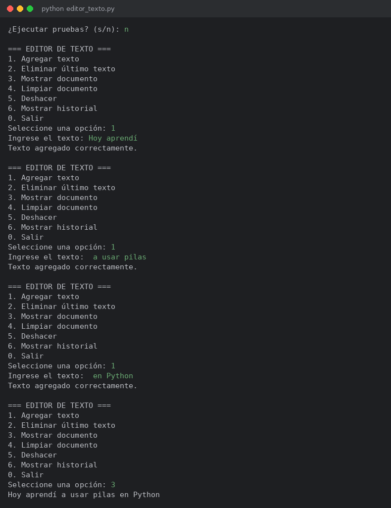
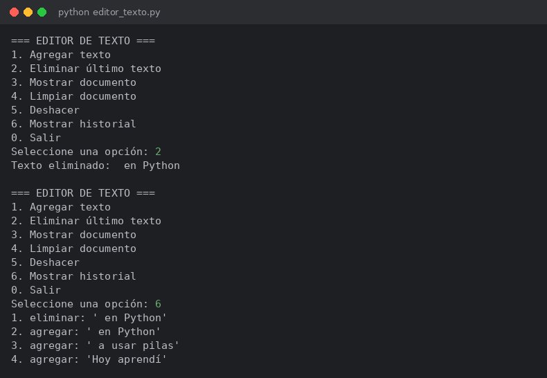
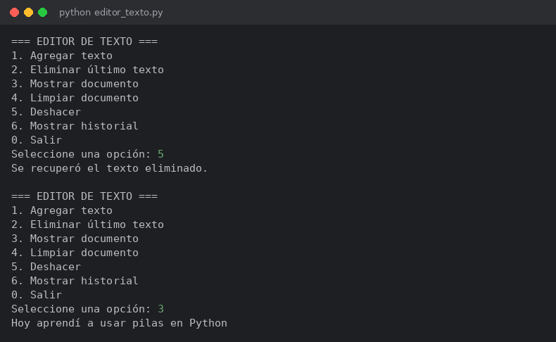
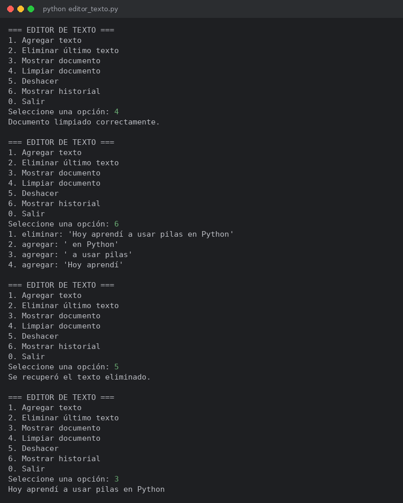
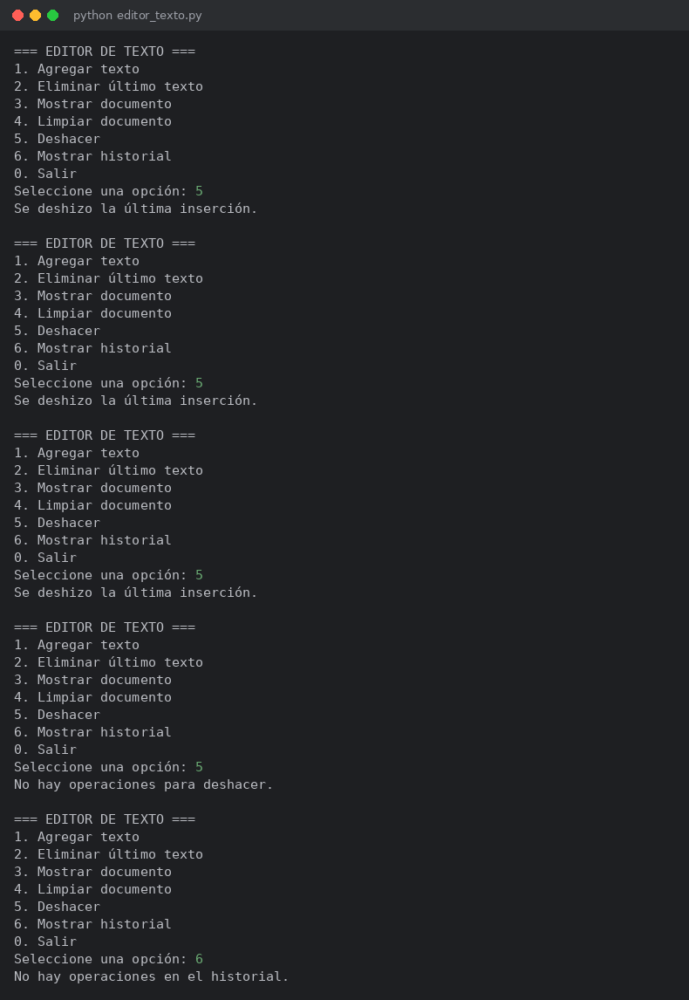
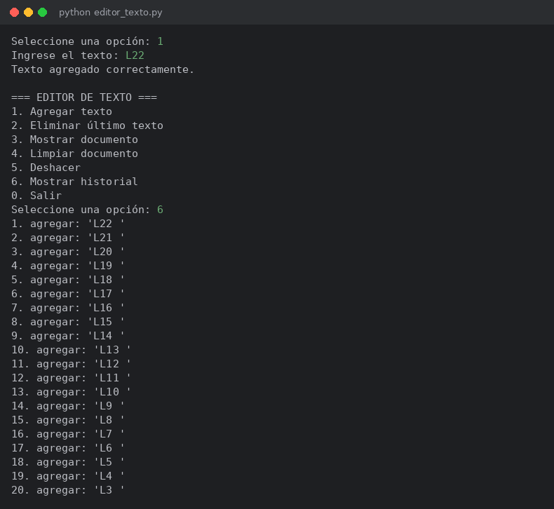
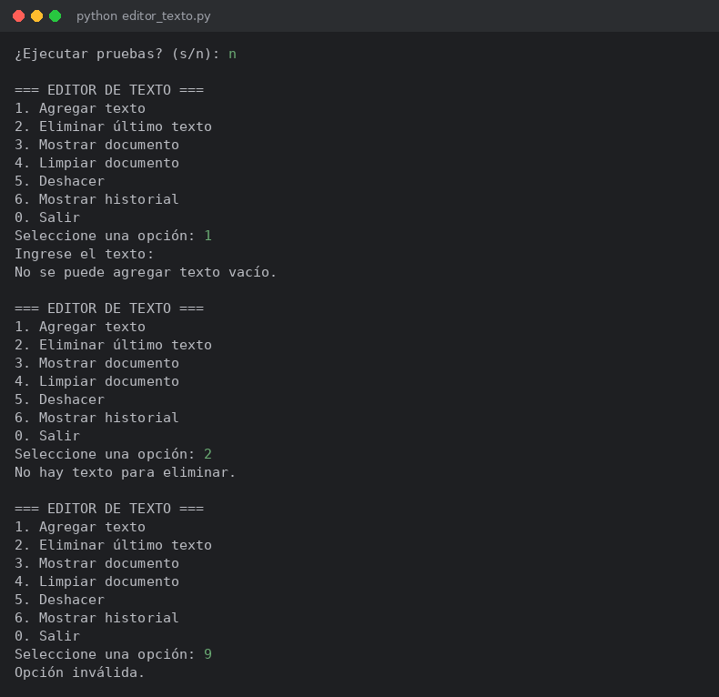
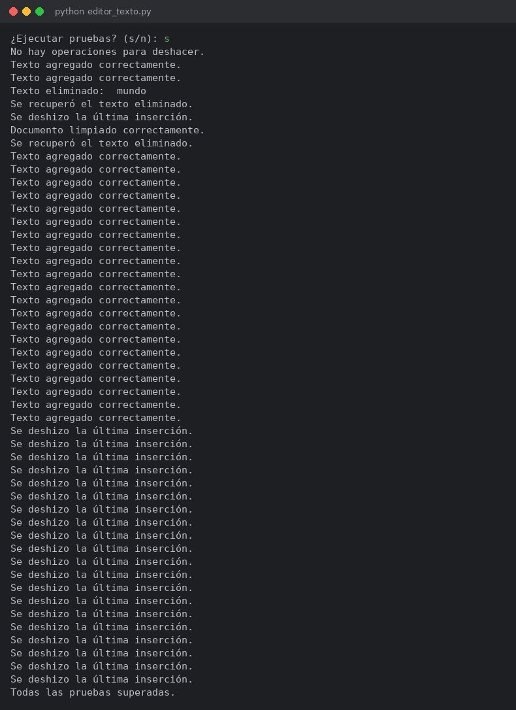

# Editor de Texto Simple con Deshacer

Batería 1 – Ejercicio 1

## Integrantes
- Reiner Soria
- Luis Huaylinos

## Introducción
Una empresa de software necesita un editor de texto básico donde se pueda escribir y volver atrás con deshacer, como el Ctrl+Z de cualquier editor. El usuario puede agregar texto al final, borrar lo último que escribió, ver el documento y limpiarlo, y cualquiera de esos cambios se puede revertir empezando por el más reciente. Como lo último que se hizo es lo primero que se deshace, usamos una pila (LIFO) con un historial de hasta 20 operaciones; cuando se llena, se descarta la más antigua. No usamos librerías externas para las estructuras de datos.

## Estructura de datos
La pila sigue el principio LIFO (Last In, First Out): la última operación registrada es la primera que se deshace. La clase Pila administra el historial y EditorTexto gestiona el documento como una lista de fragmentos.

```python
def apilar(self, operacion):
    if len(self.elementos) >= self.limite:
        self.elementos.pop(0)
    self.elementos.append(operacion)

def desapilar(self):
    return None if self.esta_vacia() else self.elementos.pop()
```

Cada entrada guarda el tipo de operación y su contenido. Cuando el historial ya tiene 20 operaciones, se saca el primer elemento de la lista, que es la operación más antigua, y recién ahí se agrega la nueva. La limpieza se registra como una eliminación de todos los fragmentos, así que también se puede revertir.

## Operaciones implementadas
| Operación | Descripción |
|---|---|
| Agregar | Añade texto al final y registra la inserción. No acepta texto vacío ni solo espacios. |
| Eliminar | Retira el último fragmento y guarda su contenido. |
| Mostrar | Presenta el documento completo. |
| Limpiar | Elimina todo el documento conservando su contenido en el historial. |
| Deshacer | Invierte la operación más reciente. Si no hay ninguna, muestra un mensaje. |
| Historial | Muestra las operaciones pendientes de deshacer, de la más reciente a la más antigua. |

## Complejidad temporal (Big O)
Sean h el número de operaciones del historial (máximo 20), n el número de fragmentos del documento y c el número de caracteres que se muestran.

| Operación | Complejidad |
|---|---|
| Apilar | O(1); cuando el historial está lleno es O(h), porque `pop(0)` tiene que correr los demás elementos. Como h nunca pasa de 20, en la práctica es constante. |
| Desapilar | O(1) |
| Agregar / eliminar último fragmento | O(1), más el costo de apilar |
| Mostrar documento | O(n + c) |
| Limpiar documento | O(n), por la copia de los fragmentos |
| Deshacer inserción | O(1) |
| Deshacer eliminación | O(k), donde k es el número de fragmentos que se recuperan |
| Mostrar historial | O(h + c) |

## Ejecución y pruebas
Requiere Python 3. Ejecutar:

```bash
python editor_texto.py
```

Responder `n` para ingresar al menú o `s` para ejecutar las pruebas automáticas. Las pruebas verifican inserción, eliminación, deshacer, limpieza y el límite de 20 operaciones, y al final muestran "Todas las pruebas superadas."

## Capturas de pantalla

Agregando tres textos y mostrando el documento:



Eliminando el último texto y revisando el historial; arriba está la operación que se deshace primero:



Deshaciendo la eliminación, el texto vuelve:



Limpiando el documento; en el historial la limpieza aparece como una eliminación de todo, y al deshacerla se recupera el texto completo:



Deshaciendo hasta que no queda nada, aparece el mensaje de que no hay operaciones:



Después de agregar 22 textos el historial solo guarda 20; L1 y L2 ya no se pueden deshacer:



Texto con solo espacios, eliminar con el documento vacío y una opción que no existe:



Pruebas automáticas respondiendo `s` al inicio:



## Conclusiones
Nos dimos cuenta de que para deshacer no hace falta guardar una copia de todo el documento: basta con el tipo de operación y el texto, y deshacer es hacer lo contrario. El límite de 20 lo resolvimos sacando la operación más antigua del inicio de la lista; funciona, aunque esa parte es O(h) porque Python tiene que correr los demás elementos. Limpiar lo guardamos como una eliminación de todos los fragmentos para que también se pueda deshacer, y en las pruebas comprobamos que después de 21 inserciones solo se pueden deshacer 20.